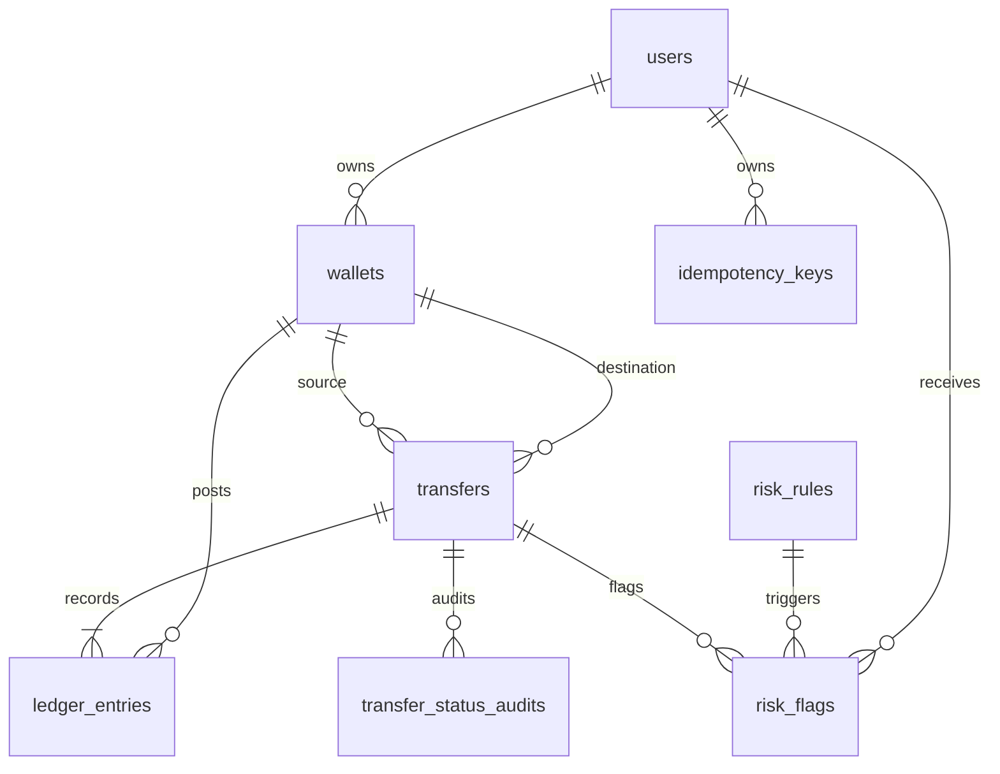

# Wallet ledger schema

## Noun and cardinality decisions

- `users`: one user has many wallets; email, phone, and name are attributes, not
  identifiers. KYC is an explicit status.
- `wallets`: stores both user wallets and system accounts. A nullable `user_id`
  distinguishes system accounts while `account_type` identifies cash-in,
  cash-out, and fee-revenue accounts. A user may own multiple wallets.
- `transfers`: one business event has two or more ledger entries. Reversals
  point to the original transfer.
- `ledger_entries`: append-only debit/credit lines. Entries reference exactly
  one transfer and one account.
- `idempotency_keys`: `(user_id, idempotency_key)` is unique and stores the
  request hash plus the first response.
- `risk_rules` and `risk_flags`: rules are reusable configuration; flags record
  each rule decision for a user and optional transfer.
- `transfer_status_audits`: immutable history of every status transition.
- `job_locks`, `reconciliation_runs`, and `reconciliation_anomalies`: serialize
  and report nightly checks.

## Money and balances

Amounts are whole paise in `BIGINT`. Ledger amounts are positive and direction
is held in `entry_type`. Stored balances make reads cheap and are checked
against the signed sum of ledger entries during reconciliation. User wallets
have a database non-negative constraint; system accounts intentionally do not.

## ER diagram

`V1` creates the core ledger, `V2` adds reconciliation audit storage, and `V3`
adds profile, transfer-type, status-audit, and report details.
